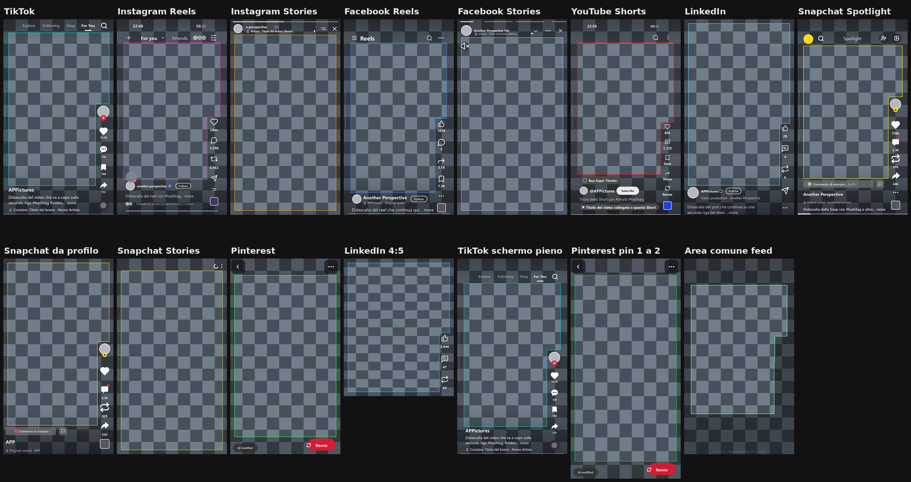

# SafeZones for DaVinci Resolve® and Adobe® Premiere Pro®

**English** · [Italiano](#italiano)

**SafeZones** draws safe-zone guides over your vertical video while you edit: the areas that the interfaces of **TikTok, Instagram (Reels and Stories), Facebook (Reels and Stories), YouTube Shorts, LinkedIn, Snapchat and Pinterest** cover on a 9:16 video. It can also show a mockup of each app, so you can frame, title and animate knowing what will stay visible.

Free and open source (MIT), by [Another Perspective Pictures](https://www.anotherperspectivepictures.com).

> [!IMPORTANT]
> The safe zones are **our own measurements**, taken on an iPhone 13 Pro in September 2026, plus the margins some platforms publish for ads. They are **not official specifications**, and apps change often: check the current specs of the platform before you deliver.
>
> **Turn the guides off before exporting**, otherwise they end up in your video.
>
> Before using it, read the **[notices](AVVERTENZE.md#english)**: SafeZones is free and experimental, provided as is, and you use it at your own risk.

## Download

**[⬇ Download SafeZones (zip)](https://github.com/AnotherPerspective/SafeZones/releases/latest/download/SafeZones.zip)**: free, no sign-up. Older versions are in [Releases](https://github.com/AnotherPerspective/SafeZones/releases).

The zip holds the three versions below, the install guides, the [notices](AVVERTENZE.md) and the [licence](LICENSE.txt).

## Three versions, same guides

| Folder | File | For | Where you use it |
|---|---|---|---|
| [`DaVinci_DCTL`](DaVinci_DCTL) | `AnotherPerspective_SafeZones.dctl` | DaVinci Resolve **Studio** | Color page, on a node or an Adjustment Clip. Has every control. |
| [`DaVinci_DRFX`](DaVinci_DRFX) | `AnotherPerspective_SafeZones_v4.2.drfx` | DaVinci Resolve 17.2 or later | Edit page, as a Fusion title. |
| [`Premiere_MOGRT`](Premiere_MOGRT) | `AnotherPerspective_SafeZones_v4.2.mogrt` | Adobe Premiere Pro | As a Motion Graphics Template on the highest track. |

Each folder has an `INSTALL.txt` with the steps, in English and Italian. Inside the programs the controls still have Italian names (Piattaforma = Platform, Modalita = Mode, Telefono = Phone): the guides explain them.

**Modes:** organic safe area (what the interface does not cover, for normal posts), official ads safe area (the margins the platforms state for ads), interface mockup, or mockup and safe area together. A **Phone** menu switches between modern tall phones and older 16:9 phones, where the app bar falls on the video.

All measurements, per platform and per phone, are in the [DCTL guide](DaVinci_DCTL/README.md).

## Source

- The **DCTL** is plain, readable source code: [`DaVinci_DCTL/AnotherPerspective_SafeZones.dctl`](DaVinci_DCTL/AnotherPerspective_SafeZones.dctl). It runs only on the image inside Resolve: it reads no files and does not connect to the internet.
- The **.drfx** (Fusion title) and the **.mogrt** (Premiere template) are packages: both are zip archives you can open to see the Fusion macro, the After Effects project and the graphics.
- The scripts we use to generate the three versions from the measurements are not in this repository yet.

## Notices, licence, trademarks

- **[Notices](AVVERTENZE.md#english)**: free, experimental, provided as is, at your own risk.
- **[MIT License](LICENSE.txt)**: use it, copy it, change it and share it, also for commercial work.
- DaVinci Resolve is a trademark of Blackmagic Design. Adobe and Premiere Pro are trademarks of Adobe Inc. TikTok, Instagram, Facebook, YouTube, LinkedIn, Snapchat and Pinterest belong to their owners, and the mockups are simplified drawings of their apps. SafeZones is not affiliated with or endorsed by any of them.
- Problems and suggestions: [open an issue](https://github.com/AnotherPerspective/SafeZones/issues) or write to info@anotherperspectivepictures.com. We are glad to read them, but this does not oblige us to answer, fix anything or provide support.

---

# SafeZones per DaVinci Resolve® e Adobe® Premiere Pro®

[English](#english) · **Italiano**

**SafeZones** disegna sopra il video verticale, mentre monti, le guide delle zone sicure: le aree che le interfacce di **TikTok, Instagram (Reels e Stories), Facebook (Reels e Stories), YouTube Shorts, LinkedIn, Snapchat e Pinterest** coprono su un video 9:16. Può mostrare anche una simulazione di ogni app, così inquadri, titoli e animi sapendo cosa resterà visibile.

Gratuito e open source (MIT), di [Another Perspective Pictures](https://www.anotherperspectivepictures.com).

> [!IMPORTANT]
> Le zone sicure sono **nostre misurazioni**, fatte su un iPhone 13 Pro a settembre 2026, più i margini che alcune piattaforme pubblicano per le inserzioni. **Non sono specifiche ufficiali**, e le app cambiano spesso: verifica le specifiche aggiornate della piattaforma prima di consegnare.
>
> **Spegni le guide prima di esportare**, altrimenti finiscono nel video.
>
> Prima di usarlo leggi le **[avvertenze](AVVERTENZE.md#italiano)**: SafeZones è gratuito e sperimentale, è fornito così com'è e lo usi a tuo rischio.

## Download

**[⬇ Scarica SafeZones (zip)](https://github.com/AnotherPerspective/SafeZones/releases/latest/download/SafeZones.zip)**: gratis, senza registrazione. Le versioni precedenti sono in [Releases](https://github.com/AnotherPerspective/SafeZones/releases).

Nello zip ci sono le tre versioni qui sotto, le guide all'installazione, le [avvertenze](AVVERTENZE.md) e la [licenza](LICENSE.txt).

## Tre versioni, stesse guide

| Cartella | File | Per | Dove si usa |
|---|---|---|---|
| [`DaVinci_DCTL`](DaVinci_DCTL) | `AnotherPerspective_SafeZones.dctl` | DaVinci Resolve **Studio** | Pagina Color, su un nodo o su un Adjustment Clip. Ha tutti i controlli. |
| [`DaVinci_DRFX`](DaVinci_DRFX) | `AnotherPerspective_SafeZones_v4.2.drfx` | DaVinci Resolve 17.2 o successivo | Pagina Edit, come titolo Fusion. |
| [`Premiere_MOGRT`](Premiere_MOGRT) | `AnotherPerspective_SafeZones_v4.2.mogrt` | Adobe Premiere Pro | Come Motion Graphics Template sulla traccia più alta. |

In ogni cartella c'è un `INSTALL.txt` con i passaggi, in inglese e in italiano.

**Modalità:** safe area organica (quello che l'interfaccia non copre, per i post normali), safe area ads ufficiale (i margini dichiarati dalle piattaforme per le inserzioni), mockup dell'interfaccia, oppure mockup e safe area insieme. Il menu **Telefono** passa dai telefoni moderni alti a quelli 16:9 più vecchi, dove la barra dell'app finisce sul video.

Tutte le misure, per piattaforma e per telefono, sono nella [guida del DCTL](DaVinci_DCTL/README.md#italiano).

## Codice sorgente

- Il **DCTL** è codice sorgente leggibile: [`DaVinci_DCTL/AnotherPerspective_SafeZones.dctl`](DaVinci_DCTL/AnotherPerspective_SafeZones.dctl). Lavora solo sull'immagine dentro Resolve: non legge file e non si collega a internet.
- Il **.drfx** (titolo Fusion) e il **.mogrt** (template di Premiere) sono pacchetti: sono archivi zip che puoi aprire per vedere la macro di Fusion, il progetto After Effects e le grafiche.
- Gli script con cui generiamo le tre versioni a partire dalle misure non sono ancora in questo repository.

## Avvertenze, licenza, marchi

- **[Avvertenze](AVVERTENZE.md#italiano)**: gratuito, sperimentale, fornito così com'è, a tuo rischio.
- **[Licenza MIT](LICENSE.txt)**: puoi usarlo, copiarlo, modificarlo e condividerlo, anche per lavori commerciali.
- DaVinci Resolve è un marchio di Blackmagic Design. Adobe e Premiere Pro sono marchi di Adobe Inc. TikTok, Instagram, Facebook, YouTube, LinkedIn, Snapchat e Pinterest appartengono ai loro proprietari, e le simulazioni sono disegni semplificati delle loro app. SafeZones non è affiliato a nessuno di loro né approvato da loro.
- Problemi e suggerimenti: [apri una segnalazione](https://github.com/AnotherPerspective/SafeZones/issues) o scrivi a info@anotherperspectivepictures.com. Li leggiamo volentieri, ma questo non ci obbliga a rispondere, correggere o dare assistenza.
